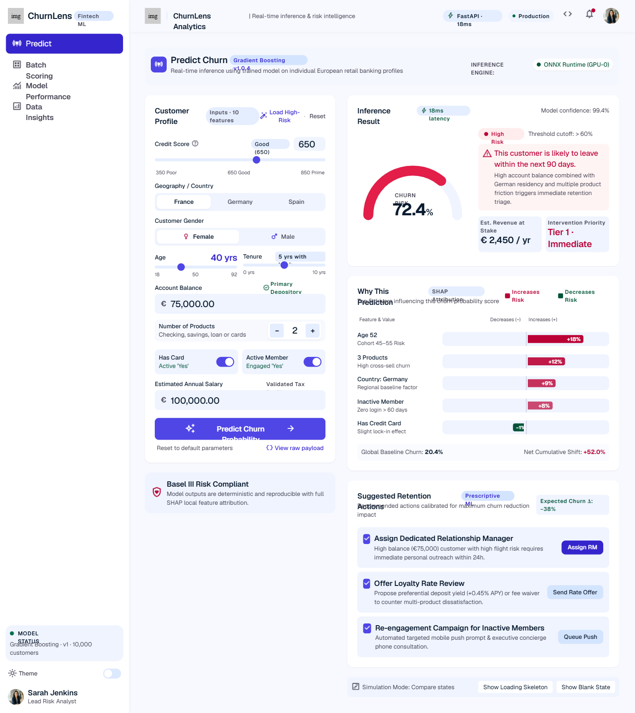
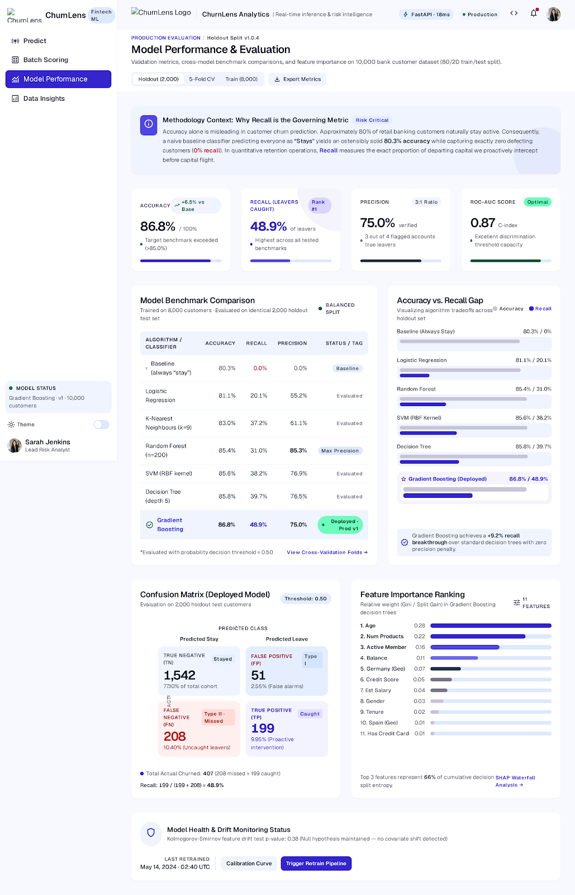

# ChurnLens: Bank Customer Churn Prediction

Exploratory data analysis and classification modelling on a bank customer churn dataset, now shipped as a
full-stack web app: a **FastAPI** backend serving a Gradient Boosting model, and a **React + Tailwind**
dashboard to score customers, explain predictions, compare models and explore the data.

| Predict | Model performance |
|---|---|
|  |  |

*(Design mock-ups from `docs/design/`; the running app uses live data from the API.)*

---

## The web app

| Screen | What it does |
|---|---|
| **Predict** | Fill in one customer's profile → churn probability gauge, risk band, the top 5 drivers as exact **SHAP values**, and rule-based retention actions. |
| **Batch Scoring** | Upload a CSV → every customer scored and ranked by risk, with search, risk filters, pagination and CSV export. A 250-customer sample CSV is downloadable from the page. |
| **Model Performance** | All 7 models on the same hold-out set: accuracy, recall, precision, ROC-AUC, accuracy-vs-recall gap, confusion matrix and feature importance. |
| **Data Insights** | Churn by country, age, products, gender and activity, plus correlations and auto-generated takeaways. Filterable by country and gender. |

Light and dark themes, responsive down to phone width (bottom tab bar).

### Run it locally

Requirements: Python 3.12+ and Node 20+.

```bash
# 1. Backend (http://localhost:8000, interactive docs at /docs)
cd backend
python -m venv .venv
.venv/Scripts/activate          # macOS/Linux: source .venv/bin/activate
pip install -r requirements.txt
python -m churn.train           # optional: the API trains on first start if no model exists
uvicorn api.main:app --reload --port 8000
```

```bash
# 2. Frontend (http://localhost:5173), in a second terminal
cd frontend
npm install
npm run dev
```

The Vite dev server forwards `/api/*` to the backend. To point a production build at a deployed API, set
`VITE_API_URL` (for example `https://churnlens-api.example.com`) before `npm run build`, and allow that
frontend origin on the API with `CORS_ORIGINS`.

### API

| Method | Endpoint | Purpose |
|---|---|---|
| `GET` | `/api/health` | Model name, version, training size |
| `GET` | `/api/metrics` | Hold-out metrics for every model, confusion matrix, feature importance |
| `POST` | `/api/predict` | Score one customer, with SHAP explanation and retention actions |
| `POST` | `/api/predict/batch` | Score an uploaded CSV (multipart `file`, up to 50,000 rows / 10 MB) |
| `GET` | `/api/sample-csv` | Download a sample CSV of real customers |
| `GET` | `/api/insights?geography=&gender=` | Segment churn statistics for the dashboard |

### Project structure

```
backend/
  churn/features.py   shared encoder (same encoding as the original scripts)
  churn/train.py      trains + evaluates all models, saves artifacts/
  churn/explain.py    exact Shapley values, segment notes, retention playbook
  api/main.py         FastAPI app
frontend/
  src/pages/          Predict, Batch, Models, Insights
  src/components/     layout, UI kit, lightweight SVG/CSS charts
docs/
  design/             Stitch design mock-ups and design system (DESIGN.md)
  design-prompt.md    prompt used to generate the design
*.py, scripting.ipynb original analysis and per-model scripts
```

---

## Dataset

`Churn_Modelling.csv`: Bank Customer Churn dataset from Kaggle (10,000 rows, 14 columns).
Target: `Exited` (1 = customer churned, 0 = customer stayed). About 20.4% of customers churned.

## Workflow

Each model follows the same pipeline:

1. Drop identifier columns (`RowNumber`, `CustomerId`, `Surname`)
2. Separate features (X) and target (y)
3. Train/test split (80/20, `random_state=42`)
4. Encode categorical features: Gender via LabelEncoder, Geography via one-hot encoding
5. Scale numeric features with StandardScaler (fit on train, transform on test)
6. Fit the model on training data
7. Predict and evaluate on test data

In the web app this pipeline is a single scikit-learn `Pipeline` (`ChurnEncoder → StandardScaler → model`),
so training and serving can never drift apart.

## Models and results

Hold-out set of 2,000 customers:

| Model | Accuracy | Recall | Precision | ROC-AUC |
|---|---|---|---|---|
| Baseline (always "stay") | 80.3% | 0.0% | 0.0% | 0.500 |
| Logistic Regression | 81.1% | 20.1% | 55.2% | 0.779 |
| K-Nearest Neighbours (k=5) | 83.0% | 37.2% | 61.1% | 0.760 |
| Random Forest (100 trees, depth 5) | 85.4% | 31.0% | 85.3% | 0.859 |
| SVM (RBF kernel) | 85.6% | 38.2% | 76.9% | 0.825 |
| Decision Tree (depth 5) | 85.8% | 39.7% | 76.5% | 0.833 |
| **Gradient Boosting (100 trees), deployed** | **86.8%** | **48.9%** | 75.0% | **0.873** |

Exact values are regenerated by `python -m churn.train` and shown live on the Model Performance page.

## Key learnings

- **The accuracy trap:** with about 80% of customers not churning, a naive "always predict no churn" model scores 80% accuracy. Raw accuracy alone is misleading on imbalanced data, so recall is the headline metric.
- **Fit/transform discipline:** encoders and scalers are fit only on training data to prevent data leakage.
- **Overfitting:** an unrestricted Decision Tree scored lower on test data than a depth-limited one, despite fitting the training data more closely. Gradient Boosting with 10,000 trees likewise scored lower than with 100.
- **Model comparison:** different models can disagree on the same prediction. Comparing them surfaces trade-offs between interpretability, accuracy and generalisation.
- **Non-linear effects:** number of products barely correlates with churn (−0.05) yet is the model's 2nd most important feature, because its effect is U-shaped (2 products is safest, 3–4 is very risky).

## Tools

**Analysis:** Python · Pandas · NumPy · Matplotlib · Seaborn · scikit-learn · Jupyter
**Web app:** FastAPI · Uvicorn · Pydantic · joblib · React 19 · TypeScript · Vite · Tailwind CSS · React Router · Lucide icons

## Authors

Original analysis and models: **Aryan Arora**.
Web app (ChurnLens API and dashboard): [SARTHAK10710](https://github.com/SARTHAK10710).
